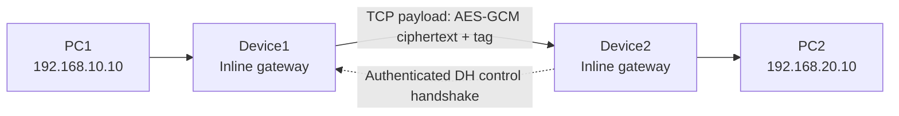

# SecureLink

**A Linux-based inline TCP payload protection prototype written in C**

SecureLink is an educational prototype for protecting selected TCP/IPv4 traffic between two Linux inline gateways:

```text
PC1 ── Device1 ═════════ Device2 ── PC2
       encrypts             decrypts
```

The gateways establish a session using ephemeral Diffie–Hellman, derive directional AES-256-GCM keys, and protect TCP payload bytes while keeping the original IP and TCP headers in place. The 16-byte GCM authentication tag is appended to the encrypted TCP payload. No UDP tunnel or additional data-packet protocol header is used.

> **Project status:** initial repository scaffold and cryptographic/packet-processing core. The staged roadmap below distinguishes implemented foundations from integration work still required. Do not treat this prototype as production-ready or expose it to untrusted networks.

## Contents

- [Design goals](#design-goals)
- [Architecture](#architecture)
- [Packet format](#packet-format)
- [Cryptographic design](#cryptographic-design)
- [Repository layout](#repository-layout)
- [Requirements](#requirements)
- [Build](#build)
- [Tests](#tests)
- [Linux lab topology](#linux-lab-topology)
- [Packet interception integration](#packet-interception-integration)
- [Security considerations and limitations](#security-considerations-and-limitations)
- [Roadmap](#roadmap)

## Design goals

1. Select TCP/IPv4 traffic using explicit source/destination address and port rules.
2. Establish a shared session secret with ephemeral Diffie–Hellman.
3. Authenticate the handshake transcript to prevent unauthenticated key substitution.
4. Derive independent traffic keys for each direction.
5. Encrypt only TCP payload bytes with AES-256-GCM.
6. Append the 16-byte authentication tag to the ciphertext.
7. Verify the tag before releasing plaintext.
8. Recalculate IPv4 and TCP checksums after packet modification.
9. Never reuse a GCM nonce with the same key.
10. Forward packets through Linux routing without UDP encapsulation.

## Architecture



Each gateway has two network interfaces and forwards traffic between its LAN-facing and transit-facing interfaces. A Linux NFQUEUE rule diverts only selected forwarded TCP packets to the SecureLink process. After transformation, the process returns the packet to the kernel for normal routing.

The return direction is protected independently: Device2 encrypts and Device1 decrypts.

## Packet format

For a protected packet, the IPv4 and TCP headers remain present. The TCP payload is transformed as follows:

```text
Before:
[ IPv4 header ][ TCP header ][ plaintext payload ]

On the inter-gateway link:
[ IPv4 header ][ TCP header ][ AES-GCM ciphertext ][ 16-byte GCM tag ]

After Device2:
[ IPv4 header ][ TCP header ][ plaintext payload ]
```

The IPv4 total length and IPv4 header checksum must be updated. The TCP checksum must be recalculated over the TCP header and transformed payload, including the IPv4 pseudo-header. On decryption, the original payload length is restored and the checksums are recalculated again.

The TCP sequence and acknowledgement numbers are not changed. Because Device2 removes the 16-byte tag before forwarding to PC2, the end hosts continue to see the original TCP byte stream.

## Cryptographic design

- **Key agreement:** ephemeral X25519 (Diffie–Hellman), implemented in `src/handshake.c`.
- **Handshake authentication:** HMAC-SHA-256 over a domain-separated, ordered transcript using a separately provisioned high-entropy pre-shared secret.
- **Key derivation:** HKDF-SHA-256, deriving independent client-to-server and server-to-client AES-256 keys.
- **Payload protection:** AES-256-GCM.
- **Authentication tag:** 128 bits (16 bytes).
- **Nonce size:** 96 bits, as recommended for GCM.

A plain Diffie–Hellman exchange does not authenticate the peer. The control handshake must authenticate the complete transcript before either gateway accepts the derived traffic keys.

### Nonce and TCP retransmission design constraint

The assignment requires a unique nonce for every encrypted packet but prohibits adding a data-packet header in which to carry a counter. A receiver must nevertheless know the nonce used by the sender. This is a real protocol-design constraint, not just a coding detail.

The implementation must therefore use a deterministic nonce derivation from authenticated, visible packet metadata and a per-flow key, with explicit handling for retransmissions, sequence-number wraparound, and flow lifetime. It must never silently fall back to a random nonce that the receiver cannot recover. A production protocol would normally carry an explicit packet number in an authenticated record header; that option is intentionally excluded by this assignment.

The final implementation must document precisely what it considers a distinct packet and how retransmissions avoid unsafe nonce reuse. Nonce reuse with different plaintext under the same AES-GCM key is catastrophic.

## Repository layout

```text
SecureLink/
├── README.md
├── LICENSE
├── Makefile
├── .gitignore
├── include/
│   ├── crypto.h
│   ├── packet.h
│   └── checksum.h
├── src/
│   ├── crypto.c
│   ├── packet.c
│   └── checksum.c
├── tests/
│   └── test_crypto.c
├── config/
│   └── README.md
├── docs/
│   └── architecture.md
└── scripts/
    └── README.md
```

## Requirements

Tested target environment: Ubuntu 22.04/24.04 or Debian 12, x86-64.

Install build dependencies:

```bash
sudo apt update
sudo apt install -y build-essential pkg-config libssl-dev
```

The NFQUEUE integration stage additionally requires:

```bash
sudo apt install -y libnetfilter-queue-dev iptables
```

## Build

```bash
make
```

Build and run the cryptographic unit test:

```bash
make test
```

Clean generated files:

```bash
make clean
```

## Tests

The unit tests verify AES-256-GCM round-trip behavior, tag verification, rejection of tampered ciphertext, X25519 shared-secret agreement, PSK transcript authentication, and matching directional HKDF outputs. The handshake primitives are implemented; the network control-channel state machine and packet forwarding integration remain subsequent work.

## Linux lab topology

Use two Linux VMs as gateways and two lightweight Linux network namespaces as end hosts. This keeps the assignment's four-node topology while requiring only two VMs.

Suggested addressing:

| Node/interface | Address | Connected network |
|---|---:|---|
| PC1 | `192.168.10.10/24` | LAN 1 |
| Device1 LAN | `192.168.10.1/24` | LAN 1 |
| Device1 transit | `10.0.0.1/30` | Transit |
| Device2 transit | `10.0.0.2/30` | Transit |
| Device2 LAN | `192.168.20.1/24` | LAN 2 |
| PC2 | `192.168.20.10/24` | LAN 2 |

Enable IPv4 forwarding on both gateways:

```bash
sudo sysctl -w net.ipv4.ip_forward=1
```

Add routes on the end hosts so PC1 reaches `192.168.20.0/24` through Device1 and PC2 reaches `192.168.10.0/24` through Device2.

Do not apply queue rules until the forwarding path has been tested without SecureLink. Keep an out-of-band VM console available when changing firewall rules.

## Packet interception integration

The intended Linux integration uses NFQUEUE on the `FORWARD` chain. The queue callback receives an IPv4 packet, transforms eligible TCP payloads, and returns the modified packet to the kernel. The kernel then routes it normally.

Example rule shape (not a complete firewall configuration):

```bash
sudo iptables -I FORWARD 1 -p tcp -s 192.168.10.10 -d 192.168.20.10 \
  --dport 9000 -j NFQUEUE --queue-num 0
```

The reverse-direction rule must also be installed. A final setup script will be provided only after the queue callback, handshake, and fail-open/fail-closed behavior are complete.

## Security considerations and limitations

- This is an educational prototype, not a replacement for IPsec, WireGuard, or TLS.
- The pre-shared handshake authentication secret must be generated randomly, distributed securely, and kept out of Git.
- Never commit private keys, PSKs, traffic keys, or packet captures containing sensitive data.
- GCM authentication must complete before plaintext is forwarded.
- Queue loss, process crashes, MTU growth, fragmentation, TCP segmentation offload (TSO/GSO/GRO), and retransmissions require explicit handling.
- A 16-byte tag increases each protected packet's size. The implementation must account for path MTU and IPv4 fragmentation behavior.
- Only selected TCP/IPv4 packets are in scope. IPv6, UDP, ICMP, and non-TCP traffic are not protected.
- The control handshake must be authenticated and replay-resistant.
- This prototype does not provide end-to-end protection if either gateway is compromised.

## Roadmap

- [x] Define the inline architecture and packet transformation model.
- [x] Add AES-256-GCM encrypt/decrypt primitives.
- [x] Add IPv4/TCP checksum helpers.
- [x] Implement X25519, PSK transcript authentication, and HKDF directional-key derivation primitives.
- [ ] Derive directional traffic keys and per-flow nonce state.
- [ ] Implement robust IPv4/TCP packet parsing and transformation.
- [ ] Integrate NFQUEUE and Linux forwarding.
- [ ] Add configuration parsing and safe startup checks.
- [ ] Add network namespace integration tests.
- [ ] Add packet-capture demonstration and final screenshots.

## License

MIT. See [LICENSE](LICENSE).
